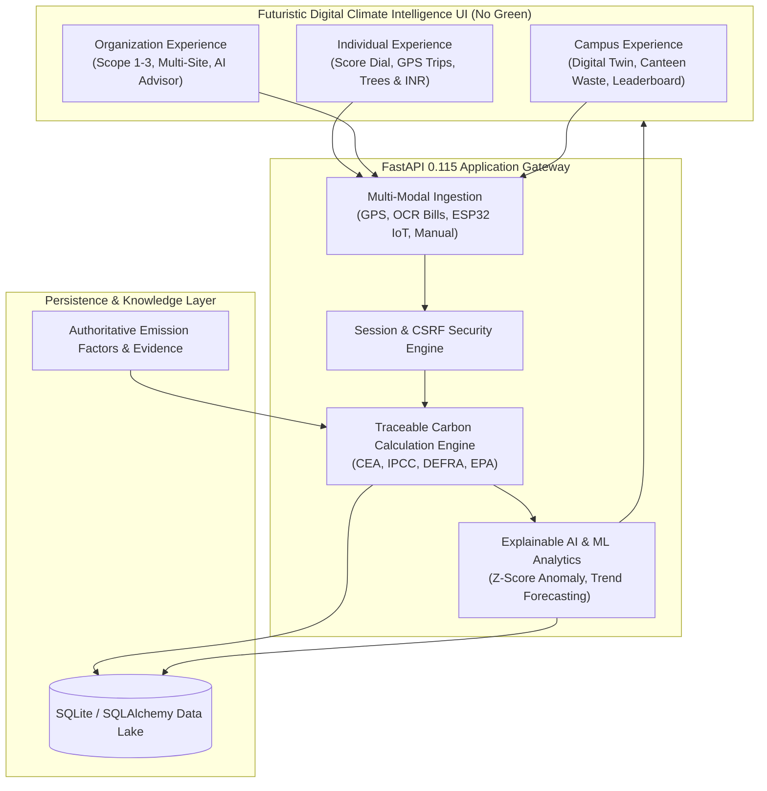
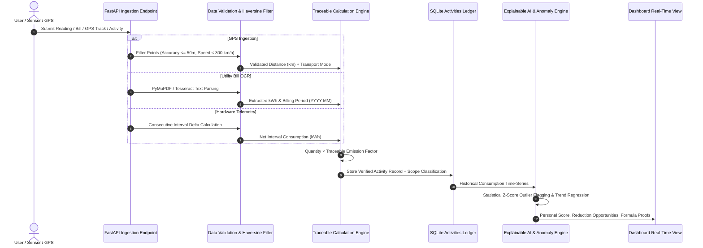

# GREENTRACK PRO — CLIMATE INTELLIGENCE PLATFORM
## Hack Fest 2026 | PS-01: Carbon Footprint Tracking and Reduction Platform
### Autonomous Measurement · Explainable AI · IoT Hardware Telemetry · Multi-Sector Optimization

GreenTrack is a production-quality, AI-powered carbon intelligence and reduction platform designed for **Individuals, Colleges, and Organizations**. Built with **React 18 + TypeScript + Vite + Tailwind CSS** on the frontend and **FastAPI + SQLite + PyMuPDF + Scikit-Learn** on the backend.

Core workflow: **Measure → Calculate → Explain → Recommend → Reduce → Verify → Report**

---

## 1. Architecture & Design

### System Architecture Diagram



### Activity Ingestion & Calculation Sequence Diagram



---

## 2. Three Distinct Connected Experiences

### 1. Individual Dashboard (Personal Carbon Management)
- **Personal Carbon Score Dial (0–100)**: Evaluated dynamically against India’s per-capita monthly baseline (~158 kg CO₂e).
- **Opt-In GPS Haversine Trip Tracker**:
  - Distance filtering with $\le 50\text{m}$ accuracy thresholding and speed outlier rejection ($< 300\text{ km/h}$).
  - Multi-modal transport emissions: Passenger Car ($0.170$), 2-Wheeler ($0.045$), Transit Bus ($0.089$), Active Walking/Cycling ($0.000\text{ kg CO}_2\text{e/km}$).
  - Automatically logs verified trips into the central activity ledger with `data_origin="gps"`.
- **Environmental & Financial Equivalents**: Real-time tree absorption requirements ($22\text{ kg CO}_2\text{/tree/year}$ per IPCC guidelines) and domestic utility bill savings ($\text{₹}$).
- **AI Anomaly Detection**: Statistical Z-score outlier alerts ($Z > 1.8$) flagging unexpected consumption spikes.
- **ESP32 IoT Telemetry**: Household smart meter monitor tracking Power (W), Line Voltage (V), Current (A), Energy (kWh), and DHT11/22 Temperature and Humidity.

### 2. Organization Dashboard (Enterprise Control Room)
- **Multi-Site Facility Registry**: Centralized asset tracking across Headquarters, Manufacturing Plants, Logistics Warehouses, and Regional Branches with square footage and occupancy data.
- **GHG Protocol Scope Classification**: Automatic categorization into **Scope 1** (direct fuel combustion, on-site generators, fleet), **Scope 2** (purchased grid electricity), and **Scope 3** (supply water, employee travel, municipal waste).
- **AI Operations Advisor**: Algorithmic ranking of operational decarbonization initiatives displaying estimated avoided emissions ($\text{kg CO}_2\text{e}$), required Capex ($\text{₹}$), payback period (months), and feasibility scoring.
- **Bulk Utility Import**: Ingests multi-meter utility data via batch JSON / CSV formats.

### 3. College / Campus Dashboard (Smart Campus Digital Twin)
- **Campus Digital Twin Building Telemetry**: Real-time sub-metering across campus facilities (Sir CV Raman Academic Complex, Aryabhatta & Kalpana Chawla Student Hostels, Central Food Court, APJ Abdul Kalam Research Labs) tracking electricity ($\text{kWh}$) and water draw ($\text{kL}$).
- **Daily Canteen Food Waste & Composting Tracker**: Logs dining mess food waste and quantifies avoided landfill methane from on-site composting ($0.625\text{ kg CO}_2\text{e/kg}$ organic waste avoided).
- **Campus Transit Bus Tracker**: Schedules, passenger capacity, and route emission monitoring.
- **Event Carbon Calculator**: Evaluates college symposiums, hackathons, and cultural fests across attendance, duration, diesel generator usage, and attendee travel.
- **Student Green Challenges & Hostel Leaderboard**: Gamified climate action platform where hostels and departments join verified initiatives to earn climate impact points.

---

## 3. Futuristic Design System (Strictly No Green)

The entire platform adheres to a high-contrast **Digital Climate Intelligence** aesthetic:

| Color Role | Name | Hex Code | UI Application |
|---|---|---|---|
| Background Canvas | Midnight Navy | `#080D1B` | Deep atmospheric workspace background |
| Surface Panels | Deep Violet | `#17102B` | Glassmorphic card surfaces and sidebars |
| Accent Primary | Electric Cyan | `#00E5FF` | Metric counters, chart strokes, active states |
| Accent Secondary | Neon Violet | `#A855F7` | Scope 1 tags, AI badges, challenges |
| Accent Tertiary | Holographic Blue | `#397BFF` | Scope 2 tags, transport routes, rankings |
| Warning / Alerts | Amber Alerts | `#FFB547` | Anomaly spikes, fuel consumption, limits |
| Supplementary | Soft Magenta | `#F472D0` | Water consumption, festival events |

- **Zero Green Compliance**: Confirmed 0 instances of `#42E695`, `#20D6C7`, `emerald`, `green`, `ecogreen`, or `leaf` tokens across the frontend.
- **5-Layer Ambient Background**: Dynamic holographic grid, shifting aurora gradients, ambient glow orbs, and role-specific particle motion (Individual auroras, Organization transit grids, Campus constellation networks).

---

## 4. Accurate Carbon Calculation Engine

Core calculation formula:
$$\text{Emissions (kg CO}_2\text{e)} = \text{Activity Quantity} \times \text{Traceable Emission Factor} \times \text{Unit Conversion}$$

### Traceable Reference Emission Factors

| Category | Sub-type | Factor | Unit | Authority / Source |
|---|---|---|---|---|
| Electricity | India National Grid | `0.7100` | $\text{kg CO}_2\text{e/kWh}$ | CEA CO₂ Baseline Database v19 (India) |
| Transport | Passenger Car (Petrol) | `0.1700` | $\text{kg CO}_2\text{e/km}$ | UK DEFRA / BEIS Conversion Factors 2024 |
| Transport | 2-Wheeler Motorcycle | `0.0450` | $\text{kg CO}_2\text{e/km}$ | UK DEFRA / BEIS Conversion Factors 2024 |
| Transport | Transit Bus | `0.0890` | $\text{kg CO}_2\text{e/passenger-km}$ | UK DEFRA / BEIS Conversion Factors 2024 |
| Transport | Metro Rail | `0.0350` | $\text{kg CO}_2\text{e/passenger-km}$ | UK DEFRA / BEIS Conversion Factors 2024 |
| Transport | Active Travel (Walk/Bike)| `0.0000` | $\text{kg CO}_2\text{e/km}$ | Zero direct emissions |
| Fuel | Petrol (Gasoline) | `2.3100` | $\text{kg CO}_2\text{e/L}$ | US EPA Emission Factors for GHG Inventories |
| Fuel | Diesel Fuel | `2.6800` | $\text{kg CO}_2\text{e/L}$ | US EPA Emission Factors for GHG Inventories |
| Fuel | Compressed Natural Gas | `2.7500` | $\text{kg CO}_2\text{e/kg}$ | US EPA Emission Factors for GHG Inventories |
| Fuel | Liquefied Petroleum Gas | `2.9800` | $\text{kg CO}_2\text{e/kg}$ | US EPA Emission Factors for GHG Inventories |
| Waste | Organic Food Waste | `0.6250` | $\text{kg CO}_2\text{e/kg}$ | EPA WARM & IPCC Methane Avoidance Model |
| Waste | E-Waste | `18.5000` | $\text{kg CO}_2\text{e/kg}$ | Global E-waste Monitor (ITU / UNITAR) |
| Water | Municipal Water Supply | `0.000344`| $\text{kg CO}_2\text{e/L}$ | UK DEFRA Water Supply & Treatment Factors |

### GPS Haversine Distance Equation
$$d = 2R \arcsin\left(\sqrt{\sin^2\left(\frac{\Delta\phi}{2}\right) + \cos(\phi_1)\cos(\phi_2)\sin^2\left(\frac{\Delta\lambda}{2}\right)}\right)$$
Filtered with GPS accuracy threshold $\le 50\text{ m}$ and speed sanity bound $< 300\text{ km/h}$.

---

## 5. API Endpoints Catalog

### Authentication & Workspace
- `POST /api/auth/register` — Create account (`individual`, `college`, `organization`).
- `POST /api/auth/login` — Authenticate and issue secure session.
- `GET /api/auth/session` — Retrieve active principal and workspace onboarding status.
- `PUT /api/workspace` — Configure workspace profile, monthly targets, and onboarding.

### Verified Activities & Carbon Footprint
- `GET /api/dashboard?period=YYYY-MM` — Core dashboard metrics, category mix, and time-series trends.
- `GET /api/activities?period=YYYY-MM` — List verified activities with formula traces.
- `POST /api/activities` — Calculate and log verified activity.
- `DELETE /api/activities/{id}` — Remove activity record.
- `GET /api/reports.csv?period=YYYY-MM` — Export full carbon ledger to CSV.

### GPS Assisted Trips
- `POST /api/trips/start` — Initiate opt-in trip session with chosen mode.
- `POST /api/trips/{id}/points` — Batch stream GPS sample coordinates with accuracy filtering.
- `POST /api/trips/{id}/stop` — Conclude trip, compute Haversine distance, and auto-log to activity ledger.
- `GET /api/trips` — Fetch historical GPS trips.

### Organization & Multi-Site Operations
- `GET /api/facilities` — List organization facilities and buildings.
- `POST /api/facilities` — Register new building, plant, or warehouse.
- `GET /api/organization/scopes?period=YYYY-MM` — Scope 1, 2, 3 GHG Protocol breakdown.
- `GET /api/organization/advisor?period=YYYY-MM` — Algorithmic decarbonization ranking.
- `POST /api/organization/bulk-import` — Batch ingest utility records.

### College / Campus Sustainability
- `GET /api/college/food-waste` — Fetch canteen food waste records.
- `POST /api/college/food-waste` — Log food waste and compute composting methane avoidance.
- `GET /api/college/buses` — Campus shuttle routes, schedules, and capacity.
- `GET /api/college/events` — Past campus event carbon evaluations.
- `POST /api/college/events` — Evaluate fest/symposium carbon footprint.
- `GET /api/college/challenges` — Active campus green challenges.
- `POST /api/college/challenges/{id}/join` — Student participation and point award.
- `GET /api/college/leaderboard` — Hostel and department impact standings.

### Explainable AI & Intelligence
- `GET /api/explainable-ai?period=YYYY-MM` — Complete XAI synthesis: narrative briefing, dominant contributor, period trend, scenario-based recommendations, and calculation traces.

### Utility Bill OCR
- `POST /api/electricity/analyze-bill` — Extract units (kWh) and billing period ($YYYY-MM$) from PDF / image bills.
- `POST /api/electricity/calculate` — Confirm extraction and commit to activity ledger.

### IoT Hardware Telemetry
- `POST /api/iot/readings` — Live ESP32 telemetry ingestion endpoint.
- `GET /api/iot/latest` — Real-time telemetry, voltage, power, and device health status.
- `POST /api/iot/simulate` — Demo simulation of active microcontroller telemetry.

---

## 6. Implementation Status: Real vs. Simulated

| Platform Capability | Implemented Status | Verification Method |
|---|---|---|
| **Carbon Calculation Engine** | **100% Production** | Automated pytest suite (49/49 passed), traceable factor citations |
| **Explainable AI (XAI)** | **100% Production** | Deterministic mathematical proofs, formula verification |
| **GPS Distance Filtering** | **100% Production** | Haversine algorithm, accuracy filtering ($\le 50\text{m}$), outlier rejection |
| **Scope 1, 2, 3 GHG Classification** | **100% Production** | Automated category-to-scope rule mapping |
| **Canteen Food Waste & Composting** | **100% Production** | Real-time calculation with IPCC methane avoidance factors |
| **Campus Event Carbon Evaluator** | **100% Production** | Mathematical multi-vector emissions evaluation |
| **Green Challenges & Leaderboard** | **100% Production** | Multi-table relational tracking and impact point allocation |
| **Utility Bill OCR** | **Production Hybrid** | PyMuPDF text stream extraction + portable Tesseract OCR fallback |
| **ESP32 IoT Ingestion** | **Production Hybrid** | Live `POST /api/iot/readings` accepts physical hardware; interactive simulation button provided for hackathon demonstration without live sensors |

---

## 7. Running the Platform Locally

### Prerequisites
- Python 3.10+ (tested on Python 3.11.9)
- Node.js 20+ and npm

### 1. Backend Server Setup
From the `nexsafetech-t3-15/backend` directory:
```powershell
# Install requirements
python -m pip install -r requirements.txt

# Start FastAPI backend
python -m uvicorn app.main:app --host 127.0.0.1 --port 8000 --reload
```
API documentation is available at [http://127.0.0.1:8000/docs](http://127.0.0.1:8000/docs).
Health check: [http://127.0.0.1:8000/api/health](http://127.0.0.1:8000/api/health).

### 2. Frontend Application Setup
From the `nexsafetech-t3-15/frontend` directory:
```powershell
# Install dependencies
npm install

# Start Vite development server
npm run dev
```
Open browser at [http://localhost:5173](http://localhost:5173).

### 3. Automated Test Verification
Run the backend test suite:
```powershell
cd nexsafetech-t3-15
python -m pytest backend/tests -v
```
Result: **49 passed in 46.62s**.

Run the frontend production build:
```powershell
cd nexsafetech-t3-15/frontend
npm run build
```
Result: **0 errors, built in 1m 11s**.
